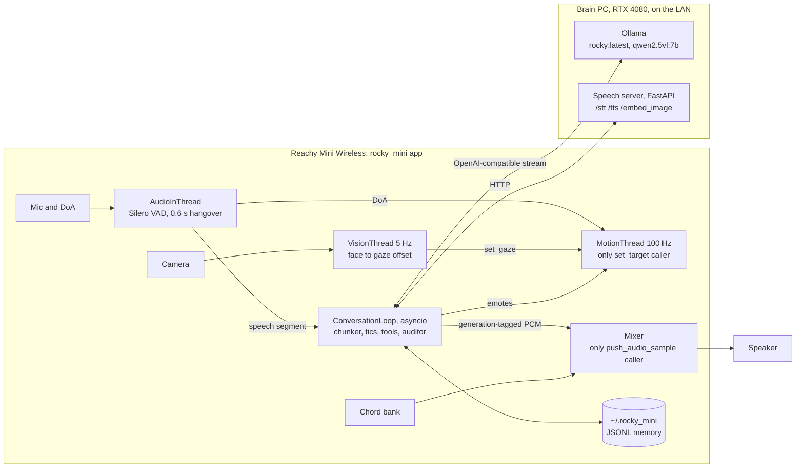

# rocky_mini

Rocky, the Eridian engineer from *Project Hail Mary*, role-played by a Reachy Mini Wireless robot. He holds spoken conversations on a fully local stack: a fine-tuned Qwen2.5-7B, local speech models, and zero paid APIs.

[](LICENSE)
[](pyproject.toml)

I teach Rocky about Earth, and he remembers what he learns across sessions, asks his own questions, and answers in a deadpan translator-box voice over Eridian chords. The robot is a thin client. Its Raspberry Pi CM4 runs motion, voice activity detection, and audio mixing, while a PC with an RTX 4080 on the LAN serves the LLM through Ollama and speech through a small FastAPI server. I built everything sim-first, so the full conversation pipeline runs on a laptop with no robot, no Ollama, and no GPU.

So far, the Rocky LoRA v2 has passed its ship gate and is tagged `rocky:latest`, the speech server runs on the PC with a movie-voice clone, and voice input has been debugged on the physical robot. The CM4 performance runs and failure drills are still open (see [Status and roadmap](#status-and-roadmap)).

## Highlights

- One owner per hardware surface. A 100 Hz `MotionThread` running `MovementManager` is the only caller of `set_target`, and the `Mixer` is the only caller of `push_audio_sample`. Barge-in bumps a global generation counter and the Mixer drops any voice tagged with a stale generation. A 60 s run against the SDK's mockup daemon logged 5,955 `set_target` calls, all from `MotionThread`.
- A custom Rocky LoRA trained on a single local GPU. Unsloth QLoRA (rank 16, 4-bit Qwen2.5-7B-Instruct base) on authored dialogues, off-novel synthetic Q&A, a neutral replay slice, and short paraphrased voice calibration (369 rows for v2, 16 percent neutral). For v2 the adapter was stream-merged shard by shard into the fp16 base (`finetune/stream_merge.py`) because the 15 GB base does not fit in WSL's RAM, then quantized to GGUF q5_K_M and served by Ollama.
- An A/B ship gate for the LoRA (`finetune/eval.py`): a 20-probe naivety red-team suite, tic metrics, tool-call validity, a verbatim memorization probe on held-out book snippets, and a general-capability regression, all scored against the stock model in the same run.
- A byte-stable persona prompt. `brain/persona.py` is a pure function guarded by a byte-stability test, so Ollama reuses the KV-cache prefix across turns, and the per-session memory digest is appended after the stable prefix.
- Naivety and memory as engineering problems. Rocky should only know Earth facts he was taught, so the prompt carries an epistemic ledger, a deterministic auditor checks every reply off the speaking path, and facts live in an event-sourced, fsynced JSONL store under `~/.rocky_mini/` with a `heard_once` to `confirmed` to `mastered` lifecycle.
- Every external service behind a Protocol with a Fake. LLM, STT, TTS, camera, face detector, image embedder, and the Reachy SDK are imported lazily, so the sim app and the pytest suite (241 test functions across 28 modules) need none of them.

## Measured results

These come from the repo's docs, script docstrings, and commit history, not from a fresh run.

| What | Result | Source |
|---|---|---|
| LoRA v2 ship gate vs stock qwen2.5 | PASS: 0/20 naivety leaks, question-particle rate 1.0, tool-call validity 1.0, memorization probe passed, capability 1.0 vs 0.875 baseline | [`decisions.md`](decisions.md) #22 |
| LoRA v1 ship gate | PASS: 1/20 leaks vs 16/20 for stock, particle rate 1.0, capability 1.0 vs 0.875 | commit `19b23f6` |
| Turn latency p50, `scripts/measure_latency.py` on the PC (Piper voice) | 1.707 s against a 2.5 s budget, measured from the last voiced frame with the 0.6 s VAD hangover included | commit `19b23f6` |
| Chatterbox clone voice cost | about 5.5 s per spoken sentence on the shared GPU; first audio trails the ack chord by about 5 s | [`decisions.md`](decisions.md) #23 |
| KV-cache prefix reuse (Ollama 0.32.1) | turn 2 prefill took 14% (rocky) and 17% (stock) of turn 1's duration | [`scripts/check_kv_reuse.py`](scripts/check_kv_reuse.py) |
| Motion loop, 60 s on a PC against the mockup daemon | 98.79 Hz mean, tick p99 10.33 ms, 0 ticks over 25 ms | [`docs/hardware-audit.md`](docs/hardware-audit.md) |
| SIGINT stop against the mockup daemon, with MotionThread, MixerPump, AudioInThread, and the asyncio loop live | clean exit in 0.86 s, antennas end at 10.0 degrees | [`docs/hardware-audit.md`](docs/hardware-audit.md) |
| Silero VAD frame-size fix, on the robot | share of frames of clean 16 kHz TTS speech scoring above 0.6: 0.63 at 256 samples vs 0.01 at 512 | commit `f615138` |

Two caveats. Eval scores are only repeatable within one Ollama server process: the same stock baseline has scored 1/20 and 16/20 leaks in different sessions, which is why the A/B gate (`--baseline`) scores candidate and baseline in a single invocation. The 1.707 s figure predates the switch to the Chatterbox voice (about 5.5 s per sentence, above).

## How it works

The app is one process on the robot with a thread per latency domain. `AudioInThread` reads the mic at 16 kHz, runs the vendored Silero VAD with a 0.6 s hangover, and polls direction of arrival. When a speech segment closes, the asyncio `ConversationLoop` sends the audio to `/stt`, fires an ack chord and thinking pose, and streams the reply from Ollama. A sentence chunker pulls out `[emote:NAME]` and `[sfx:NAME]` tags and runs a tic linter (it enforces the `, question?` particle, strips assistant-isms, and flags word tripling for a reflex emote), so TTS starts on sentence one while the model is still writing sentence two. Each sentence is synthesized on the PC and queued on the Mixer, which adds a light ring-modulation edge (wet/dry 0.2), sums the chord bus, soft-clips, and pushes frames to the speaker.

After the reply, tool calls are validated with pydantic and dispatched (`remember_fact`, `confirm_fact`, `note_open_question`, `set_sleep_watch`, `look_around`, `teach_object`), the naivety auditor runs, and a deterministic curiosity scheduler decides whether Rocky may ask one proactive question next turn. If STT, the LLM, or TTS fails, the loop catches it, plays a canned fallback clip when one is configured (see the wiring gap under [Status and roadmap](#status-and-roadmap)), and stays alive for the next utterance.



Rules the code is built around (the full list is in [`CLAUDE.md`](CLAUDE.md); the reasoning behind each is in [`decisions.md`](decisions.md) and [`docs/hardware-audit.md`](docs/hardware-audit.md)):

- Never call the SDK's `play_move`, `cancel_move`, `goto_target`, or `play_sound`. Emotes are a few procedural trajectories plus 13 Pollen recorded trajectories vendored into `rocky_mini/assets/emotes/`, all sampled inside `MotionThread` (the recorded ones through a `RecordedTrajectory` adapter).
- Vision stays client-side. Face tracking feeds `MovementManager.set_gaze()`, which reconciles a fresh face against DoA before the single per-tick `set_target`; the daemon's `start_head_tracking()` is never called. `ROCKY_VISION_ENABLED=0` falls back to DoA only.
- Pose clamps: pitch and roll within 40 degrees, head-to-body yaw within 65 degrees, antennas never commanded to 0 (rest is about 10 degrees).
- Latency is measured from the user's last voiced frame, hangover included.
- Memory lives in `~/.rocky_mini/`, because dashboard updates reinstall the app with `pip --force-reinstall`.

Vision has three parts: a 5 Hz `VisionThread` for gaze, a `look_around` tool that describes the room with a local vision model on Ollama (`qwen2.5vl:7b` by default), and few-shot visual object memory. For the last one, `teach_object` embeds the current camera frame with a frozen DINOv2 ViT-S/14 on the speech server and stores up to three shots per object; recognition takes the max cosine over an object's shots and accepts a match at 0.60 or above. When two or more objects are enrolled, it also requires a 0.08 margin over the runner-up. Both thresholds are provisional. Design notes are in [`docs/visual-memory-plan.md`](docs/visual-memory-plan.md).

## Tech stack

| Layer | Tools |
|---|---|
| Robot app | Python 3.11+, reachy-mini SDK (optional `robot` extra, audited against 1.9.0), NumPy, SciPy, onnxruntime, FastAPI, pydantic-settings |
| Brain | Ollama serving Qwen2.5-7B-Instruct plus the Rocky LoRA (`rocky:latest`), `openai` client pointed at Ollama |
| Speech server | faster-whisper (STT), Piper `en_US-lessac-medium`, Coqui XTTS v2, or Chatterbox (TTS), DINOv2 via `torch.hub`, librosa |
| Fine-tuning | Unsloth QLoRA under WSL2, TRL, PEFT, llama.cpp GGUF conversion |
| Tests | pytest, pytest-asyncio, pytest-mock, a Playwright script for the settings UI |

## Getting started

### Run it in sim (no robot, no Ollama, no GPU)

```bash
git clone https://github.com/TirtheshJani/rocky_mini.git
cd rocky_mini
python -m venv .venv && source .venv/bin/activate   # Python 3.11+
pip install -e ".[dev]"
python -m pytest -q
rocky-mini --sim --host 127.0.0.1 --port 8042        # same as: python -m rocky_mini.main --sim ...
```

Open http://127.0.0.1:8042. The settings UI has a chat box that drives a real `ConversationLoop` turn (answered by the rule-based `SimResponder`), a fact table with confirm and delete, emote buttons, a live metrics stream with a latency meter against the 2.5 s budget, a model toggle and brain URL field, and memory export. Sim memory is written to `~/.rocky_mini/`, the same place the robot uses.

The LoRA ship gate also has a sim mode: `python finetune/eval.py --sim`.

### Run the brain on a PC

```bash
ollama pull qwen2.5:7b-instruct-q5_K_M
ollama serve                                         # verify: curl http://localhost:11434/api/version

pip install -r server/requirements.txt               # faster-whisper, Piper, torch, coqui-tts, librosa
# put Piper's en_US-lessac-medium.onnx and .json in the directory you launch from
uvicorn server.app:app --host 0.0.0.0 --port 8123    # verify: curl http://localhost:8123/health
```

The speech server picks its voice with `ROCKY_TTS_BACKEND`: `piper` (default, fast), `clone` (XTTS v2), or `chatterbox`. Chatterbox (the `chatterbox-tts` package) is not in `server/requirements.txt`; its `transformers` pin conflicts with Coqui's, so it runs from its own venv ([`decisions.md`](decisions.md) #23). Any clone failure falls back to Piper.

Then point the app at the PC in `~/.rocky_mini/.env` (never in the repo; [`.env.example`](.env.example) lists the core keys, and every `ROCKY_*` setting is defined in [`rocky_mini/config.py`](rocky_mini/config.py)):

```
ROCKY_LLM_BACKEND=ollama                       # default is "fake" (SimResponder)
ROCKY_LLM_BASE_URL=http://<pc-lan-ip>:11434/v1
ROCKY_SPEECH_BASE_URL=http://<pc-lan-ip>:8123
ROCKY_MODEL=qwen2.5:7b-instruct-q5_K_M         # or rocky:latest once you build the LoRA
ROCKY_AUDIO_BACKEND=reachy                     # on the robot; sounddevice or fake on a PC
ROCKY_VISION_BACKEND=reachy                    # camera; default fake
ROCKY_FACE_DETECTOR=daemon                     # or haar (needs cv2); default fake
```

### Install on the robot

The dashboard installs apps from a Hugging Face Space or a local folder, not from a GitHub URL. Either publish the repo as a private Space and install it from the dashboard, or SSH in once, clone, and `pip install -e .` into the robot's apps venv. The `reachy_mini_apps` entry point registers `RockyMiniApp`; the daemon launches `python -u -m rocky_mini.main` and stops it with SIGINT. Then work through [`docs/bring-up.md`](docs/bring-up.md) in order. [`docs/tutorial.md`](docs/tutorial.md) covers the full first-day path from an assembled robot.

### Train the Rocky LoRA (optional)

The dataset and model stay local and are not distributed (`finetune/data/*.jsonl` is gitignored). The runbook in [`finetune/README.md`](finetune/README.md) covers dataset building (`make_seed.py`, `neutral.py`, `synth.py`, `mine_book.py`, `build_dataset.py`), training under WSL2, merge and quantize, and `ollama create rocky`. Gate it before switching `ROCKY_MODEL`:

```bash
python finetune/eval.py --model rocky:latest --baseline qwen2.5:7b-instruct-q5_K_M
```

### Measurement scripts

```bash
python scripts/measure_latency.py --turns 8              # live Ollama + speech server, per-stage p50s
python scripts/measure_latency.py --text-only            # skip STT
python scripts/check_kv_reuse.py --model rocky:latest    # or the stock tag; verdict from prompt_eval_duration
ROCKY_AUDIO_BACKEND=fake python scripts/gate_jitter.py   # 60 s motion-loop jitter, needs a running daemon
python scripts/profile_budget.py                         # per-tick CPU cost of the hot loops (POSIX only)
```

## Repository layout

```
rocky_mini/
├── rocky_mini/            # the robot app package
│   ├── main.py            # RockyMiniApp (daemon entry), hardware thread supervision, rocky-mini CLI
│   ├── app.py             # AppState wiring and the settings UI API
│   ├── turn.py            # ConversationLoop state machine, TurnMetrics, barge-in
│   ├── config.py          # ROCKY_* settings, read from env and ~/.rocky_mini/.env
│   ├── sim_brain.py       # rule-based SimResponder for sim and tests
│   ├── audio/             # AudioIO seam, AudioInThread, Silero VAD, Mixer, DSP, chord bank
│   ├── brain/             # persona, chunker, tics, tools, LLM seam, auditor, curiosity, reflection
│   ├── memory/            # event-sourced fact store, taught-object store
│   ├── motion/            # 100 Hz MovementManager, pose clamps, emotes, idle, wobble
│   ├── speech/            # STT/TTS seams, brain-server clients, canned fallback
│   ├── vision/            # camera and face-detector seams, VisionThread, VLM observer, embedder
│   ├── static/            # settings UI
│   └── assets/            # vendored emote trajectories, canned WAVs, silero_vad.onnx
├── server/                # PC speech server: /stt, /tts, /embed_image
├── finetune/              # LoRA dataset builders, train.py, stream_merge.py, eval.py, Modelfiles
├── scripts/               # latency, KV-reuse, jitter, and CPU-budget checks; asset builders
├── tests/                 # pytest suite, integration/ sim end-to-end, ui/ Playwright script
├── docs/                  # bring-up checklist, tutorial, SDK hardware audit, visual-memory design
├── plan.md                # original design and milestones
├── decisions.md           # dated decisions with reasoning and reversal conditions
└── agents.local.md        # robot, PC, and runtime environment notes
```

## Status and roadmap

Built and covered by unit tests: the sim app and settings UI, motion core with emotes, Eridian audio and chord bank, the conversation loop, naivety checks, memory with export and import, voice input, and the vision features. On the PC and the robot: the LoRA was trained, gated, and shipped twice on the local PC (v1 on 2026-07-20, v2 on 2026-07-23), the speech server runs the Chatterbox voice on the PC, and three bugs that kept Rocky deaf on the physical robot (a DoA USB fault that killed the mic thread, the VAD frame size, and unwired STT/TTS clients) were fixed and verified there.

Still open:

- The 60 s jitter run on the robot's CM4 and the CPU budget check (the [`docs/hardware-audit.md`](docs/hardware-audit.md) addendum is marked pending). The fallback if the CM4 cannot hold 100 Hz is a 60 Hz motion loop.
- The failure drills in [`docs/bring-up.md`](docs/bring-up.md) step 12 (brain server down, Wi-Fi pulled, SIGINT mid-speech, rapid barge-in).
- The echo-cancellation test before turning on open-mic barge-in. Half-duplex stays the default until it passes on the robot (decisions #6 and #9).
- Voice latency with Chatterbox. Decision #23 points to streaming generation or a faster clone model if the delay grates, not more DSP.
- Probes still pending: the vision model choice (`qwen2.5vl:7b` vs `moondream`, decision #20) and the object-match threshold and margin (decision #21).
- The six offline fallback clips in `rocky_mini/assets/canned/` are still chord stand-ins from `scripts/make_canned.py`, not spoken lines.
- A wiring gap in `rocky_mini/main.py`: the hardware path points `CannedTTS` at `assets/canned/` at the repo root, while the tracked clips live in `rocky_mini/assets/canned/`, and it attaches the fallback after `ConversationLoop` has already preloaded emote clips. So on a fresh clone, neither the brain-failure clips nor the emote voice clips load on the robot (the loop still survives the failure). Unit tests cover the clip logic by passing the clip directory in directly.
- `ReflectionWorker` (post-session summary for the next greeting) and the speech-driven head wobble (`MovementManager.feed_audio_rms`) are implemented and tested, but nothing in the live path calls them yet.

## Acknowledgements

- [Reachy Mini](https://docs.pollen-robotics.com/) and the `reachy-mini` Python SDK by Pollen Robotics. The app's launch contract and every SDK call were audited against version 1.9.0.
- Emote trajectories: 13 moves vendored from Pollen Robotics' [reachy-mini-emotions-library](https://huggingface.co/datasets/pollen-robotics/reachy-mini-emotions-library) by `scripts/fetch_emotes.py`. Their audio tracks are discarded; Rocky's own short emote lines were rendered through the speech server's Piper voice by `scripts/make_emote_voices.py` into `rocky_mini/assets/canned/emotes/`.
- [Silero VAD](https://github.com/snakers4/silero-vad) (MIT, Silero Team), vendored as `rocky_mini/assets/models/silero_vad.onnx` from silero-vad 6.2.1 so the robot runs it without torch.
- Qwen2.5-7B-Instruct (Apache-2.0) served by Ollama; the LoRA is trained with [Unsloth](https://github.com/unslothai/unsloth). Speech and vision models: faster-whisper, Piper, Coqui XTTS v2, Chatterbox by Resemble AI, and DINOv2.
- The movie-voice clone approach follows pedramamini's rocky_say gist (details in [`server/README.md`](server/README.md)). The novel and all derived training data stay local ([`decisions.md`](decisions.md) #14), and the clone's reference audio is read from `~/.rocky_say/` on the PC; none of it is part of this repo.

## Author

Tirthesh Jani ([GitHub](https://github.com/TirtheshJani), [LinkedIn](https://www.linkedin.com/in/tirthesh-jani))

## License

MIT. See [LICENSE](LICENSE).
